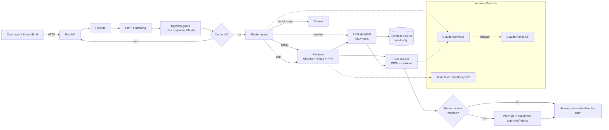

# BenefitIQ - Health Plan Benefits & Policy Assistant

[](https://github.com/sai-4321/benifitiq/actions/workflows/ci.yml)

An AI assistant for care teams that answers **Medicare coverage** and **member plan** questions with citations,
built on **Claude via Amazon Bedrock**: hybrid RAG over public Medicare.gov booklets, a **LangGraph** multi-agent
workflow, **MCP** tools for member data, PHI masking, prompt-injection guards and **human-in-the-loop** review.

> **Data policy:** public Medicare.gov publications (public domain) and **synthetic** members only - no real
> patient data, ever. See [docs/DATA_SOURCES.md](docs/DATA_SOURCES.md).

## Architecture



## Tech stack

| Area | Tools |
|---|---|
| LLM + embeddings | Claude Sonnet 5 / Haiku 4.5 and Titan Text Embeddings V2 on Amazon Bedrock (boto3, langchain-aws) |
| Agents | LangGraph (state machine, conditional routing, `interrupt()` human review, checkpointer) |
| Retrieval | pypdf, LangChain text splitters, ChromaDB, rank-bm25, Reciprocal Rank Fusion |
| Tools | Model Context Protocol (official Python SDK, FastMCP, stdio) |
| Reliability | Pydantic v2 contracts, validate-and-retry JSON, tenacity, botocore adaptive retries, model fallback, diskcache |
| Safety | PII/PHI masking, prompt-injection rules + Claude classifier, minimum-necessary tool data |
| Observability | LangSmith tracing (redacted inputs), token + cost accounting, `/metrics` |
| Serving | FastAPI, Streamlit, Docker, docker-compose |
| Quality | pytest (offline: Bedrock stubbed, fake LLM), ruff, GitHub Actions CI, 44-question eval harness |

## Quick start (Windows PowerShell)

Prerequisites: Python 3.12, Git, and an AWS account with Claude enabled on Bedrock - see
**[docs/AWS_SETUP.md](docs/AWS_SETUP.md)** (about 20 minutes, once).

```powershell
git clone https://github.com/sai-4321/benifitiq.git
cd benifitiq
py -3.12 -m venv .venv
.\.venv\Scripts\Activate.ps1
pip install -r requirements.txt
Copy-Item .env.example .env              # then paste your Bedrock API key (or use "aws configure")

python scripts/check_bedrock.py          # 3 x OK = Claude + Titan reachable
python scripts/download_docs.py          # 4 public Medicare.gov PDFs
python scripts/generate_synthetic_data.py
python scripts/ingest.py                 # chunks + Titan embeddings -> ChromaDB

uvicorn app.api.main:app --port 8000     # terminal 1  (docs: http://localhost:8000/docs)
streamlit run ui/streamlit_app.py        # terminal 2  (http://localhost:8501)
```

Or with Docker: `docker compose up --build` (after the download / generate / ingest steps, which fill `./data`).

Run the tests (no AWS needed): `pytest` - and the evaluation: `python evals/run_eval.py`.

## Configuration

All settings live in one typed class, `app/config.py`, loaded from `.env` (documented in `.env.example`).
Real environment variables override `.env`, which overrides the defaults in code. Keys are `SecretStr` and never
appear in logs. `.env` is git-ignored - never commit it.

## AI models (all on Amazon Bedrock)

| Role | Model | Setting |
|---|---|---|
| Main LLM | Claude Sonnet 5 | `BEDROCK_CHAT_MODEL_ID=us.anthropic.claude-sonnet-5` |
| Automatic fallback | Claude Haiku 4.5 | `BEDROCK_FALLBACK_MODEL_ID` (`none` = off) |
| Embeddings | Amazon Titan Text Embeddings V2 (1024-d) | `BEDROCK_EMBED_MODEL_ID` |

If Sonnet fails (throttling, timeout, outage), botocore retries with back-off and LangChain re-sends the
same request to Haiku. Check your AWS setup once with:

```powershell
python scripts/check_bedrock.py
```

Tests never call AWS: they stub Bedrock with botocore's `Stubber`.

## Guardrails: PII/PHI masking

Before any text reaches Claude, logs or the cache, `app/guardrails/pii.py` swaps identifiers for placeholders:

```
Patient John Smith (M1003), SSN 123-45-6789, call 469-555-0134
-> Patient [NAME_1] ([MEMBER_ID_1]), SSN [SSN_1], call [PHONE_1]
```

Detected: SSN, Medicare Beneficiary Identifier (MBI), email, phone, date of birth, member ID, and names after
cue words (patient, member, named, Dr., Mr./Mrs./Ms.). The placeholder map never leaves the API process, so the
answer can be un-masked only for the authorized user. Production upgrade: Amazon Comprehend Medical `DetectPHI`
or Amazon Bedrock Guardrails sensitive-information filters.

## Guardrails: prompt injection

`app/guardrails/injection.py` checks every (masked) question before any LLM call:

1. **Rules** (always on, ~0 ms): named regex rules for instruction override, system-prompt leaks, role hijack,
   jailbreak keywords, bulk data exfiltration ("list all members' SSNs"), SQL/code and fake system tags.
2. **Classifier** (optional): a pluggable `(text) -> (is_injection, reason)` hook for attacks the rules miss.
   If it errors, the rules-only result stands - the guard never crashes a request.

Blocks are explainable (rule names are returned and logged; the attack text never is). The test suite checks
both directions: every attack is blocked, and look-alike normal questions ("Can a plan ignore a prior
authorization request?") are not.

## Retrieval (hybrid RAG)

```powershell
python scripts/download_docs.py   # 4 public Medicare.gov PDFs -> data/raw/
python scripts/ingest.py          # pages -> 800/120 chunks -> Titan embeddings -> ChromaDB + chunks.jsonl
```

Each question runs two searches and fuses them with Reciprocal Rank Fusion (`score = sum 1/(60 + rank)`):
vector search (Titan embeddings in ChromaDB) finds meaning ("mobility aid" -> walkers), BM25 finds exact terms
("Part B", "63 days"). If the embedding call fails, keyword results still come back.
Production mapping: Amazon OpenSearch Serverless hybrid query, or Bedrock Knowledge Bases.

## Member tools (MCP)

Member and plan facts come from an **MCP server** (`app/mcp_server/server.py`), not from free-form SQL. It exposes
three typed, read-only tools over the synthetic database:

| Tool | Input (validated before running) | Returns |
|---|---|---|
| `get_member_plan` | `member_id` matching `^M\d{4}$` | plan ID/name/type, coverage start, status - no names, DOB or phone |
| `get_plan_benefits` | `plan_id` matching `^PLN-\d{3}$` | deductible, copays, OOP max, coinsurance, referral rule |
| `check_prior_auth` | `plan_id` + `service` from a fixed list | whether prior authorization is required, with notes |

Try it in any MCP client (e.g. Claude Desktop `claude_desktop_config.json`):

```json
{"mcpServers": {"benefitiq": {"command": "python", "args": ["-m", "app.mcp_server.server"],
  "cwd": "C:/path/to/benifitiq"}}}
```

## Agents (LangGraph)

```
            START
              |
           router ------------------------------------------------+
   policy /   | member          \ both                             | out_of_scope
          v   v                  v                                 v
    retriever  lookup (MCP) <--- retriever, then lookup          refuse -> END
          \      |
           v     v
          summarizer (JSON + citations) -> human_review (pause if needed) -> END
```

- **router** - Claude classifies intent and service; keyword heuristic if Claude fails.
- **retriever** - hybrid search; **lookup** - MCP member tools; **summarizer** - validated JSON with citations,
  invented citations dropped, uncited answers capped at 0.3 confidence.
- **human_review** - LangGraph `interrupt()` pauses member-specific, low-confidence or flagged answers until a
  supervisor approves or rejects (resume by `thread_id` from the checkpointer).

`app/pipeline.py` runs the whole request: **mask PII -> injection guard -> cache -> graph -> unmask**. Masking is
first, so nothing downstream (classifier, Claude, cache, logs, traces) ever sees raw identifiers.

## API

```powershell
uvicorn app.api.main:app --reload --port 8000      # docs: http://localhost:8000/docs
```

| Method | Path | Purpose |
|---|---|---|
| GET | `/health` | ready? (indexed chunks, member DB, model) |
| POST | `/ask` | `{"question": "...", "member_id": "M1002"}` -> `completed`, `blocked` or `pending_approval` |
| POST | `/approve` | supervisor approves/rejects a pending answer by `thread_id` |
| GET | `/pending` | answers waiting for review (masked questions only) |
| GET | `/metrics` | requests, cache hits, blocks, approvals, latency, tokens, cost |

## UI

```powershell
streamlit run ui/streamlit_app.py     # http://localhost:8501 (needs the API running)
```

Chat with demo questions, answer + confidence + citations, a "what the LLM saw" panel showing the masked question
and retrieved chunks, and a supervisor approve/reject panel for answers that need human review.

## Evaluation

```powershell
python evals/run_eval.py              # 44 questions, with Claude-as-judge groundedness
python evals/run_eval.py --no-judge   # cheaper/faster
python evals/run_eval.py --pause 5    # if Bedrock throttles a new account
```

| Metric | What it measures |
|---|---|
| route accuracy | router picked policy / member / both / out_of_scope as expected |
| injection block rate | attack prompts in the golden set were blocked |
| doc hit@k, evidence hit@k, MRR | retrieval: right document in top-k; first chunk containing the expected fact, and its rank |
| keyword recall | answer contains the expected facts (with alternatives, e.g. `doesn't cover\|does not cover`) |
| citation accuracy | citations point at retrieved chunks and their quotes really appear there |
| groundedness | Claude-as-judge: share of answer claims supported by the retrieved context |
| latency p50/p95, tokens, cost | from Bedrock usage metadata |

Results are written to `evals/results/` (git-ignored) as a per-question CSV and a summary JSON. The numbers
depend on your AWS run, so record them from your own `summary_*.json`.

## Production mapping (AWS)

| Demo | Production |
|---|---|
| ChromaDB + rank-bm25 + RRF | Amazon OpenSearch Serverless hybrid query, or Bedrock Knowledge Bases |
| SQLite + MCP over stdio | MCP server container (ECS Fargate / EKS) over streamable HTTP, IAM / Cognito auth |
| diskcache | Amazon ElastiCache (Redis / Valkey) |
| In-memory LangGraph checkpointer and pending store | Postgres checkpointer on Amazon RDS / Aurora |
| `.env` + Bedrock API key | AWS Secrets Manager + IAM role on the task (no long-term keys) |
| Regex PII masking + regex injection rules | Amazon Comprehend Medical `DetectPHI` + Amazon Bedrock Guardrails |
| LangSmith | LangSmith plus CloudWatch metrics and Bedrock model-invocation logging |
| docker-compose | ECS / EKS, image in Amazon ECR, deployed by the CI/CD pipeline |
| Synthetic data | Real PHI only on HIPAA-eligible services under a signed AWS BAA |

## How this was built

Run like a team project: every change is a ticket ([docs/BACKLOG.md](docs/BACKLOG.md), Issues BIQ-1 to BIQ-16),
a branch (`feature/BIQ-n-...`), small Conventional Commits, a pull request with the template checklist, green CI
(ruff + pytest + Docker build), then a squash merge. Three sprints became three releases - see
[CHANGELOG.md](CHANGELOG.md). Two real bugs were caught by tests along the way: an over-eager SQL injection rule
(#21) and a raw member ID leaking into the LLM prompt through tool results (#29).

## Known limitations

- Regex PHI masking only catches names after cue words and doesn't detect addresses (production: Comprehend Medical).
- Pending human reviews and the LangGraph checkpointer are in memory - a restart loses them (production: Postgres).
- No authentication on the API; reviewer names are self-reported (production: Cognito / SSO and audit logging).
- Medicare.gov links always serve the newest edition; `data/raw/manifest.json` records which one an index was built from.
- Plan values and members are invented for the demo and don't describe any real insurer.

## License

Code: [MIT](LICENSE). The Medicare.gov documents the app downloads are U.S. Government works in the public domain;
they are not included in this repository.
